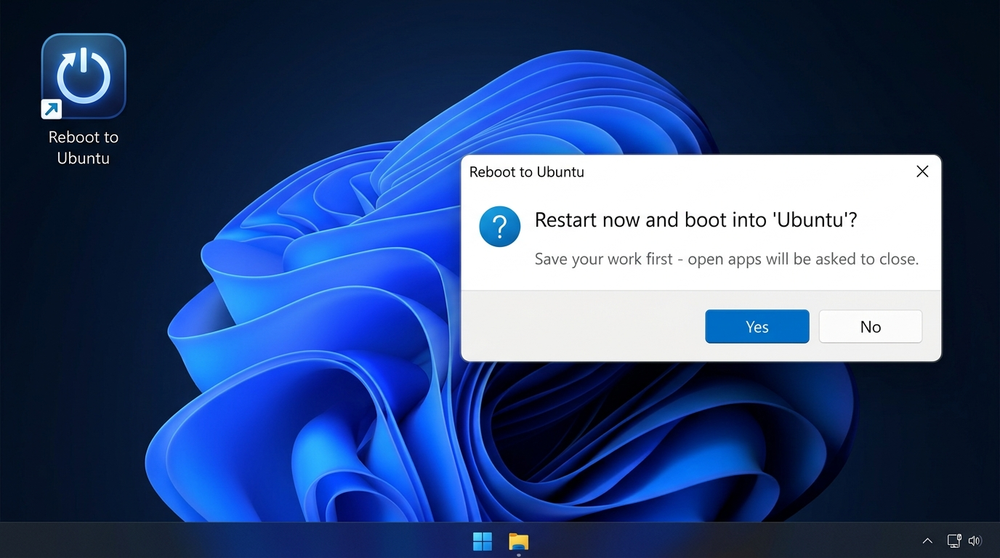
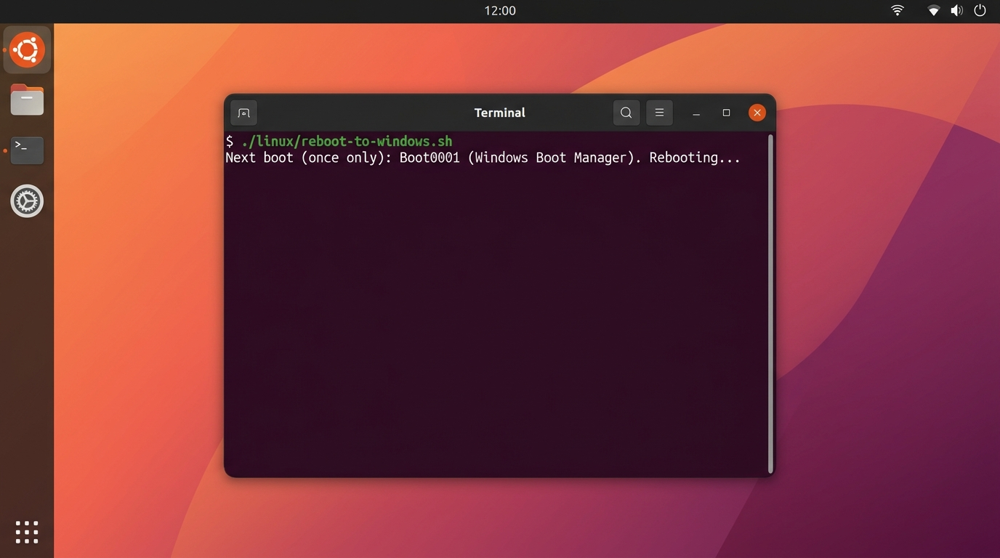

# dualboot-switch

One-click **Windows 11 → Ubuntu** reboot (plus an optional Ubuntu → Windows script) for a dual-boot where Ubuntu lives on an external USB NVMe SSD.

## GUI Preview

| Windows 11 → Ubuntu | Ubuntu → Windows 11 |
| :---: | :---: |
|  |  |

## How it works
The tool sets the UEFI **`BootNext`** variable with `bcdedit /set {fwbootmgr} bootsequence {id}`. The firmware then boots the Ubuntu entry **once only**. Your normal boot order isn't changed, so you never need to open the BIOS boot menu or change the boot order.

## Install (Windows)
1. Plug in the external SSD.
2. Right-click `Install.ps1` → **Run with PowerShell**, or run:
   ```powershell
   powershell -ExecutionPolicy Bypass -File .\Install.ps1
   ```
3. Approve UAC, then pick your Ubuntu entry. It's usually `ubuntu`. A `UEFI: <SSD name>` entry also works.

You get a **"Reboot to Ubuntu"** shortcut on the Desktop and in the Start Menu. Clicking it shows a Yes/No dialog and reboots straight into Ubuntu, with no UAC prompt.

Installer options: `-NoConfirm` (skip the dialog), `-NoDesktopShortcut`, `-Delay <sec>`.

> Keep this folder where it is after installing: the task and shortcuts point to it.
> If you move it, run `Install.ps1` again.

## Command-line use
```powershell
.\RebootToUbuntu.ps1            # confirm, then reboot into Ubuntu
.\RebootToUbuntu.ps1 -Force     # no confirmation
.\RebootToUbuntu.ps1 -List      # show all UEFI boot entries
.\RebootToUbuntu.ps1 -Setup     # re-pick the Ubuntu entry
.\RebootToUbuntu.ps1 -NoReboot  # only set BootNext
.\RebootToUbuntu.ps1 -Clear     # cancel a pending BootNext
.\RebootToUbuntu.ps1 -Id "{guid}"
```
The script relaunches itself as admin when needed.

## Ubuntu → Windows (optional)
```bash
sudo apt install efibootmgr
chmod +x linux/reboot-to-windows.sh
./linux/reboot-to-windows.sh
```

## Getting straight to the desktop
- **Skip the GRUB menu:** in `/etc/default/grub` set `GRUB_TIMEOUT_STYLE=hidden` and `GRUB_TIMEOUT=0`, then run `sudo update-grub`.
- **Skip the login screen (optional):** Settings → System → Users → *Automatic Login*.

## Troubleshooting
| Symptom | Cause / Fix |
|---|---|
| Windows boots again instead of Ubuntu | The SSD wasn't connected, so the firmware fell back to the normal order. Or your firmware ignores `BootNext` for USB devices: try picking the `UEFI: <SSD name>` entry with `-Setup`. |
| "Could not find the Ubuntu UEFI boot entry" | Some firmwares delete entries for disks that were missing at boot. Boot Ubuntu once from the F12/F11 boot menu, run `sudo grub-install` (or `sudo efibootmgr -c -d /dev/sdX -p 1 -L ubuntu -l '\EFI\ubuntu\shimx64.efi'`), then run `-Setup`. |
| Parsing finds nothing | `bcdedit` output is localized. On a non-English display language, use `-Id {guid}` from `bcdedit /enum firmware`. |
| Windows NTFS drives are read-only in Ubuntu | Turn off Windows *Fast Startup* (Control Panel → Power Options). |

## Uninstall
Run `Uninstall.ps1`.

## License
[MIT](LICENSE) © 2026 Raushan Kumar Chaudhary
